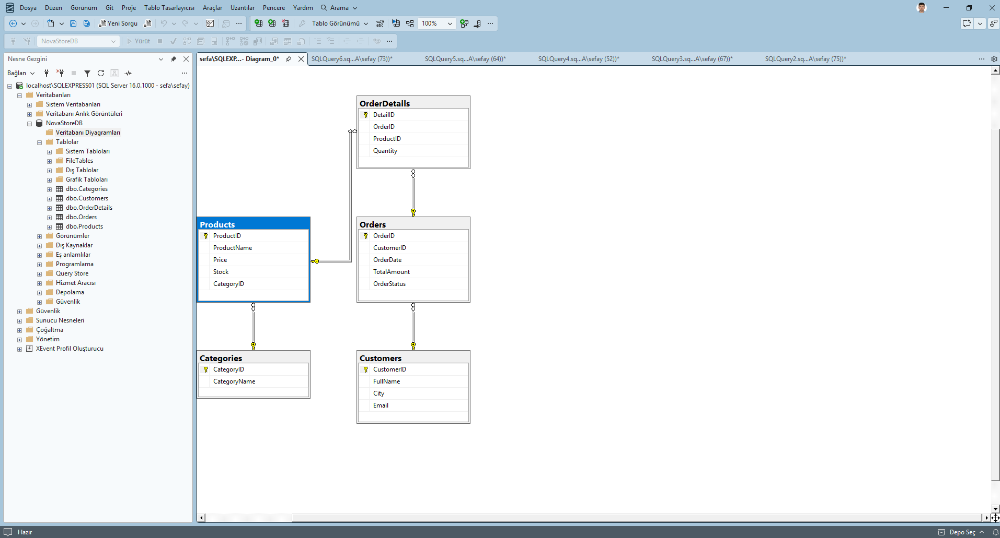

# 🛒 NovaStore E-Ticaret Veri Yönetim Sistemi (MS SQL Server / T-SQL)


**Bitirme Projesi:** Veri Tabanı & SQL Eğitimi  
**Eğitmen:** Salih Tekin  
**Kurum:** TNC Group (Software Persona Staj Programı)  
**Geliştirici:** Sefa Yusuf Kütük  
**Konsept:** Gaming & Yazılımcı Ekipmanları E-Ticaret Veri Mimarisi  

---

## 📌 Proje Genel Bakışı

**NovaStore**, yüksek hacimli bir e-ticaret platformunun operasyonel veri ihtiyaçlarını karşılamak üzere tasarlanmış kurumsal düzeyde bir **Microsoft SQL Server (T-SQL)** ilişkisel veritabanı yönetim sistemidir.

Standart şablonların ötesine geçilerek; veri bütünlüğünü donanımsal seviyede koruyan **CHECK kısıtlamaları**, sipariş verildiğinde stokları anında güncelleyen **otomatik TRIGGER mekanizması**, işlemleri tek bir güvenli işlem çatısında toplayan **STORED PROCEDURE** ve kurumsal analiz raporları sunan **VIEW & DQL sorguları** ile donatılmıştır.

---

## 🏗️ İlişkisel Veritabanı Mimarisi (ER Şeması)

Sistem 5 ana tablodan oluşur ve 3. Normal Form (3NF) kurallarına tam uyumludur:

```text
[Categories] (1) ──< (N) [Products] (1) ──< (N) [OrderDetails] (N) >── (1) [Orders] (N) >── (1) [Customers]
```



### 📊 Tablo Yapıları ve Kısıtlamalar (Constraints)

| Tablo Adı | Birincil Anahtar (PK) | Yabancı Anahtarlar (FK) | Mühendislik Kısıtlamaları (CHECK / UNIQUE) |
| :--- | :--- | :--- | :--- |
| **Categories** | `CategoryID` | - | Kategori adı zorunlu (`NOT NULL`) |
| **Products** | `ProductID` | `CategoryID` | `CK_Products_Price (Price > 0)`, `CK_Products_Stock (Stock >= 0)` |
| **Customers** | `CustomerID` | - | `UQ_Customers_Email (UNIQUE)` |
| **Orders** | `OrderID` | `CustomerID` | `CK_Orders_Status ('Hazırlanıyor', 'Kargoya Verildi', 'Teslim Edildi', 'İptal Edildi')` |
| **OrderDetails** | `DetailID` | `OrderID`, `ProductID` | `CK_OrderDetails_Quantity (Quantity > 0)` |

---

## 🌟 Projemizin 6 Büyük Değeri

1. **Tam Korumalı Veri Bütünlüğü (CHECK & UNIQUE):** Eksi stok, sıfır/negatif fiyat ve mükerrer e-posta gibi veri tutarsızlıklarını veritabanı motoru seviyesinde engeller.
2. **5'li Zincirleme İlişkisel Sorgulama (INNER JOIN):** Müşteri, sipariş, sepet detayları, ürün ve kategori tablolarını tek bir sorguda bağlayan kurumsal veri analizi.
3. **Otomatik Stok Düşürme Trigger'ı (`trg_UpdateStockAfterOrder`):** Yeni bir sipariş kalemi girildiği anda ilgili ürünün stok adedini otomatik olarak azaltır.
4. **Hata Korumalı Sipariş Prosedürü (`sp_CreateOrderWithDetails`):** `BEGIN TRANSACTION` ve `TRY...CATCH` bloklarıyla sipariş ve detay kaydını atomik olarak işler, hata anında `ROLLBACK` yapar.
5. **Ciro ve Zaman Analitiği (DQL):** `SUM`, `COUNT`, `AVG` fonksiyonları ve `DATEDIFF` zaman filtreleri ile son 30 günlük ciro, kategori bazlı satış ve en çok kazandıran ürün analizleri.
6. **Kurumsal Raporlama View'ı (`vw_CustomerOrderSummary`):** Karmaşık join sorgularını tek bir sanal tabloda toplayarak performanslı ve kolay raporlama sağlar.

---

## 🚀 Yerel Kurulum ve Çalıştırma (SSMS)

### Adım 1: SQL Dosyasını Açın
* **Microsoft SQL Server Management Studio (SSMS)** veya **Azure Data Studio**'yu başlatın.
* `NovaStore-Proje.sql` dosyasını SSMS içine sürükleyip bırakın.

### Adım 2: F5 Tuşuna Basın
* Script, başında bulunan `DROP DATABASE IF EXISTS` bloğu sayesinde her çalıştırmada veritabanını sıfırdan kurar ve hiçbir çakışma yaşatmaz:
```sql
USE master;
GO
CREATE DATABASE NovaStoreDB;
GO
USE NovaStoreDB;
GO
```

---

## 📸 Test ve Doğrulama Ekran Görüntüleri

Tüm tablolar, sorgu sonuçları, trigger testleri ve ilişkisel diyagram ekran görüntüleri `ekran_goruntuleri/` klasöründe yer almaktadır:

1. `Adim-1_DDL_Veritabani_ve_Tablo_Tasarimlari.png` - Tabloların oluşturulması
2. `Adim-2_DML_Veri_Girisi_ve_Kontrol.png` - Gerçekçi veri seti girişi
3. `Adim-3_DQL_Temel_Sorgular_ve_5li_JOIN.png` - 5 tablonun birleştiği analiz
4. `Adim-4_DQL_Ciro_ve_Zaman_Analizleri.png` - Ciro, stok ve zaman filtreleri
5. `Adim-5_View_ve_TRY_CATCH_Hata_Yonetimi.png` - View ve hata kalkanı
6. `Adim-6_Stored_Procedure_ve_Trigger_Testi.png` - Otomatik stok düşürme testi
7. `Adim-7_Iliskisel_Veritabani_Semasi_Diagram.png` - İlişkisel ER diyagramı

---

## 👨‍💻 Geliştirici Bilgisi

* **Geliştirici:** Sefa Yusuf Kütük  
* **GitHub:** https://github.com/SeFaYuSuFk  
* **Eğitmen:** Salih Tekin  
* **Kurum:** TNC Group (Software Persona 2026 Staj Programı)  
